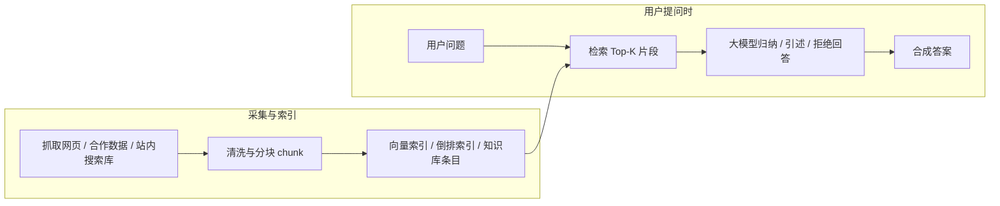

# GEO（生成式引擎优化）详细指南

本文面向 **品牌、内容、增长与产品团队**，说明如何在「对话式搜索、AI 摘要、多步检索」显著增长的环境下，提高组织与产品 **被理解、被引用、被正确转述** 的概率。指南 **不限于某一技术栈或本项目**，可与 SEO、内容运营、公关与合规协同落地。

---

## 1. GEO 是什么，解决什么问题

**GEO（Generative Engine Optimization，生成式引擎优化）** 泛指：围绕 **大模型、生成式搜索、智能摘要、Agent 检索** 等新入口，系统化设计 **事实口径、内容形态与信源结构**，以减少：

- **实体误绑**：品牌/产品与同名或近似概念被混为一谈；
- **事实扭曲**：版本、价格、适用范围、资质被错误概括；
- **过度承诺**：模型替品牌说出并未经核证的收益或合规结论；
- **引用缺位**：官方应有说法但内容过散、过软、过「营销腔」，无法形成可摘录块。

与传统 **SEO** 对比（见第 3 节），GEO 更关注 **「语言模型可用的证据与结构」**，而非仅网页排名与点击量。

---

## 2. 为什么现在需要单独谈 GEO

- **答案先行**：用户越来越常在对话界面里直接获得合成答案，而不是逐站点点击。
- **摘录机制**：系统往往偏好 **短结论 + 要点列表 + 明确边界**，而非长篇叙事。
- **多源糅合**：错误常来自 **多处弱信源叠加**；官方若缺少 **高密度、可核对** 表述，就会被论坛、二手文章或过时页面「带偏」。
- **更新滞后**：训练与索引均有延迟；**显式「最后更新」与变更日志** 有助于人机对齐时间线。

GEO **不是**「骗术」或「提示词黑客」：以造假、 keyword stuffing、虚构背书适配模型，短期可能有害品牌与合规，长期不可持续。

---

## 3. SEO 与 GEO：差异与协同

| 维度 | SEO（典型） | GEO（典型） |
|------|-------------|-------------|
| 主要目标 | 排名、点击、收录 | 口径一致、可摘录、可核对、少误述 |
| 内容单元 | 页面、内链、关键词集群 | **可摘录块**、实体说明、对比表、FAQ |
| 成功信号 | 流量、排名、CTR | 摘要中品牌是否被正确指称、要点是否可溯源 |
| 技术抓手 | Meta、站点架构、速度 | 结构化叙述、一致术语、可选 Schema、机器可读摘要 |

**协同方式**：

- **同一套事实源**：先定「实体与术语表」「一句话」「边界条款」，再派生 SEO 页面与 GEO 剪裁版。
- **高意图页面**：FAQ、对比、定价说明、安全与合规章节，同时服务搜索点击与模型摘录。
- **不要两套矛盾说法**：SEO 标题党与 GEO 需要的「可核对陈述」冲突时，以 **合规与可验证** 为准。

---

## 4. 核心原则（建议写进内部规范）

### 4.1 实体一致性（Entity consistency）

- **canonical 名称**：对外主名称、产品代号、子品牌关系固定（文档中写明「勿用旧名 ×××」）。
- **版本与地域**：同一产品在不同地区、版本的功能差异 **单独成段**，避免一句概括全球。
- **价格与条款**：涉及价格、违约、退费、数据驻留等，用 **「以官网/合同当前页为准」** + 指向稳定 URL（或「最后更新」日期）。

### 4.2 可摘录性（Extractability）

模型与摘要系统偏爱：

1. **首句结论**：一句话回答「这是什么 / 适合谁 / 核心限制」；
2. **3–7 条要点**：短句、并行结构；
3. **否定与边界**：**不适合谁、不承诺什么** 往往比堆砌卖点更能减少误读；
4. **可复制结构**：对比表（维度列清楚）、步骤列表、时间与适用范围。

### 4.3 可验证性（Verifiability）

- **可证事实**与 **观点/愿景** 分开写；
- 关键数字、奖项、引用第三方评价：**给出来源或标注「需市场/法务确认」**，禁止让编者随手填；
- **监管敏感行业**（医疗、金融、法律）：结论性措辞遵循法务审核节奏，GEO 文案与免责声明同级维护。

### 4.4 时间与维护

- 页面级或站点级维护 **`最后更新：YYYY-MM-DD`**（或与变更日志联动）；
- **重大变更**（价格、API 行为、数据留存）要有「面向模型的简短变更摘要」，便于与旧摘要对齐时间线。

---

## 5. GEO 具体要如何做：执行清单与分工

本节回答「到底要谁、在什么时间、改什么文件/页面」。可与第 7 节的阶段模型对照使用。

### 5.1 一周内可启动的「最小闭环（MVP）」

| 顺序 | 动作 | 负责角色 | 产出物 |
|------|------|----------|--------|
| 1 | 定 **canonical 产品名** 与禁用旧称、内部代号对照表 | 品牌/产品 | 半页术语表 |
| 2 | 收集客服/销售前 **20 个真实问句**（用户若去问 AI 也会这么问） | 客服/销售/运营 | 问题清单 |
| 3 | 每个高频意图写 **一个「可摘录块」**（见第 8.1 节骨架） | 内容 + 产品审核 | 5–10 块 Markdown/文档 |
| 4 | 把上述块 **同步**到：官网关键页、帮助中心首段、应用商店长描述（勿各写各的） | 市场/研发协作 | 统一口径的线上页面 |
| 5 | 在关键页脚或文首增加 **「最后更新：日期」** + 指向条款/价格的稳定链接 | 内容 | 可追溯时间线 |
| 6 | **人工抽检**：用同一组问题在 1–2 个对话式产品中提问，截屏记录错答类型 | 增长/PM | 问题登记表（实体/事实/边界类） |
| 7 | 按登记表 **只改最高频、最高风险** 的官方段落，再抽检一轮 | 内容闭环 | 修订记录 |

### 5.2 一月内建议补齐的「增强项」

- **对比表 + 「不适用」行**：减少模型在「和竞品比」「能不能用」类问题上自圆其说。  
- **FAQ**：每条**可独立阅读**（主语写全，避免「它支持吗」但上文未定义「它」）。  
- **开发者/集成文档**：API 行为、弃用（deprecation）、错误码——减少技术向误答。  
- （可选）**机器可读摘要**：如简短 `llms.txt`、或 JSON 事实文件 + 与页面文案**同源**，避免两份内容漂移。  
- （可选）与页面一致的 **Schema.org**，不在标记里写页面正文没有的承诺。

### 5.3 常见协作节奏（双周）

- **周一**：汇总新问法、新错答（来自抽检、工单、社媒）。  
- **周三**：内容组改「可摘录块」；产品核对事实；法务过敏感段。  
- **周五**：发布上线；更新「最后更新」；记录变更一行话（给未来模型索引用）。

### 5.4 「不要做什么」（执行层红线）

- 不同渠道长期使用 **两套互相矛盾** 的卖点或参数。  
- 把未经确认的数据写进「可被当成事实摘走」的首段。  
- 只做 Keyword 堆砌、不做**结论文案 + 边界** 的结构改写。

---

## 6. 从人工智能的角度：系统如何「读」你的内容（原理与举例）

下面用 **朴素工程视角** 说明：对话式搜索、检索增强生成（RAG）、网页摘要等系统，**大致**会怎样利用你的页面（各厂商实现不同，以下抓共性）。理解后，你就能反推「该怎样写、写在哪里」。

### 6.1 典型路径：从网页到用户看到的「AI 回答」



对你的启示：**被检索到的往往是「小块文本」**；若关键定义在第十段才出现，而分块恰从中间切开，模型可能**根本看不到**正确定义。

### 6.2 分块（Chunking）视角：为什么要「结论写最前」

**坏例（散文式，关键信息后置）**：

> 去年我们团队经历了多次迭代，客户 success story 遍布金融与制造。在这一过程中，**SuperNote 分析平台**逐渐成为企业侧的首选……（第五段才真正解释产品是什么、对谁有用）

**AI 侧风险**：某一趟检索若只命中前几段，模型可能把产品概括成泛化的「企业服务」「迭代故事」，**丢失正式产品名与边界**。

**好例（可摘录块在前）**：

> **SuperNote 分析平台**是面向 **大型企业数据团队** 的本地化分析工具，用于 **在私有云内** 完成报表与权限管控；**不提供**公有 SaaS 免费试用，**不面向**个人开发者。  
> **要点**：……  
> **最后更新**：2026-05-01。

**AI 侧收益**：即使只命中首块，也较易形成 **正确实体 + 否定边界**，减少「可以免费试用」类幻觉。

### 6.3 实体消歧：同名、多版本、多地区

**坏例**：

> 「智航」支持多语言客服。

若市场上存在 **智航标准版 / 智航国际版 / 另一公司的智航**，模型极易 **绑错实体**。

**好例**：

> **智航客服机器人（智航公司，产品代号 ZH-CS-2025）** 在 **中国大陆部署版本** 中支持中文与英文工作台；**港澳台部署版本** 的功能以当地官网说明为准。

加上 **公司全名、代号、地域** 可显著降低检索阶段的实体混淆（人类读起来稍长，但 GEO 目标不同纯品牌散文）。

### 6.4 「否定句」如何抑制模型的过度承诺

**坏例**：

> 使用本平台即可快速实现合规。

模型可能加强为「完全合规」「通过所有审计」——**超出你原意**。

**好例**：

> 本平台提供 **审计日志与权限分级能力**，协助组织满足 **常见的内控** 要求；**不等同于**通过任何特定国家的强制认证，**具体合规结论需客户自行与审计/法务确认**。

否定与限定给模型提供了 **可引用的护栏**，与法务免责声明衔接。

### 6.5 模拟：若用户向 AI 提问，会需要页面上有什么？

下面用 **虚构产品** 演示「用户问题 → 页面应备信息」；你可替换为自己的产品线做演练。

| 用户可能问 AI 的话 | 建议在官方站点出现的可核对信息 |
|--------------------|----------------------------------|
| 「A 和 B 能一起用吗？」 | 同一帮助文档中 **并列** 写清 A、B 名称；**兼容矩阵**（版本号×场景）；明确「不支持」的组合 |
| 「价格多少？」 | **定价页**写清计价维度（席位/调用量/年付）；文首注明「以结账页为准」；避免过期数字留在旧博客 |
| 「数据存哪里？」 | **数据驻留**单独成段：区域、是否客户 VPC、保留期；与隐私政策链接一致 |
| 「和某某竞品最大区别？」 | **对比表** + 每项附 **我们理解下的差异**（避免贬损性不实陈述，法务审核） |

### 6.6 RAG / 问答机器人场景：给「引用片段」留钩子

若你自己在产品里接了 **企业知识库 RAG**，GEO 写作仍适用，且更「技术具体」：

- 每条政策类段落结尾加 **稳定锚点**：`… 详见《安全白皮书》第 3.2 节（文档 ID: SEC-3.2）`，便于引用与回归测试。  
- **同一事实只维护一处权威版本**，其它页面用「摘要 + 链接」，避免知识库里多段**互相矛盾**的副本被同时检索到。  
- 更新时至少保留 **一行变更说明**：「2026-05 起 API 速率限制由 X 改为 Y」，方便旧问答被纠正。

### 6.7 自检小练习（团队可用）

1. 任选一页产品说明，**遮住第一段**：同事仅凭后面段落能否写出正确的一句话定义？若不能，把定义前移。  
2. 抽 **10 个用户问句**，逐句问：**页面上是否存在可直接拷贝作为答案要点的句子？** 若没有，补「可摘录块」。  
3. 检查是否存在 **两个 URL** 对同一参数给出 **不同数字**；若有，指定一页为 canonical 并修正另一页。

---

## 7. 方法论：分阶段落地（通用 Playbook）

以下为多数组织可剪裁沿用的 **0–4 阶段**。可与项目管理里的 RACI 结合使用。

### 阶段 0：诊断（Discovery）

- **实体清单**：品牌、产品线、SKU、集成名称、内部代号（哪些可对用户说）。
- **意图地图**：用户/客户会如何用自然语言问到你（功能、对比、价格、故障、集成、合规）。
- **信源审计**：官方站点、帮助中心、应用商店、开发者文档、社媒、新闻稿、第三方评测——**哪里说法不一致**？
- **风险登记**：易被误绑的同名、易被夸大效果的功能、易被错误类比的竞品。

**产出**：实体表、意图×信源矩阵、风险清单。

### 阶段 1：信息架构（IA for GEO）

- 为每类高频意图设计 **「可摘录块」模板**：结论文案 → 要点 → 边界/不适用 → （可选）链接到深度文档。
- 建立 **术语表**（中英、缩写、禁用别名）。
- 规定 **长文档策略**：首屏必须出现「可摘录块」，其后才是案例与故事。

**产出**：模板库、术语表、内容 brief 规范。

### 阶段 2：内容资产生产（Assets）

按优先级产出（可并行）：

- **一句话 + 段落版**（用于「关于我们」「产品概要」）；
- **一页纸 PDF/HTML**（销售与合作伙伴常问）；
- **对比表**（与常见替代方案：维度含适用人群、限制、集成成本口径）；
- **FAQ**（从真实工单、销售异议、搜索词来，而非空想）；
- **更新日志 / 发布时间线**（尤其对开发者产品）。

**产出**：可直接发布的页面/块，中英版本若需要则同步维护。

### 阶段 3：可信、合规与信源（Trust）

- **法务/合规**：审查高敏页面清单与固定免责声明位置；
- **数据与隐私**：说明收集什么、为何、保留多久——避免模型替你「脑补」；
- **第三方引用**：仅使用可追溯来源；新闻稿与媒体转载分清「官宣」与「评论」。

**产出**：审核过的标准段落、禁止用语表、官方引用白名单。

### 阶段 4：抽检与迭代（Evaluate）

- **模拟问答**：定期构造 10–30 个真实用户口吻问题，在主要 **对话式搜索/模型产品** 上人工抽查（注意各平台政策与条款）。
- **记录**：错误类型归类（实体错误、版本错误、缺失边界、过度承诺）。
- **回填**：优先修 **高风险 + 高频** 的信源页与「可摘录块」。

**产出**：季度 GEO 简报、修订 backlog。

---

## 8. 内容与体裁：可直接套用的模块

### 8.1 「可摘录块」骨架（中文示例结构）

```text
【一句话】<产品名> 是面向 <人群/场景> 的 <品类>，用于 <核心价值>；不适用于 <明确排除场景>。

【要点】
- …
- …

【边界与合规】<定价/疗效/收益/合规> 以 <官方 URL 或合同> 为准；本文档最后更新：<日期>。
```

### 8.2 对比表列建议

| 维度 | 我们 | 替代方案 A | 说明/限制 |
|------|------|------------|-----------|
| 适用场景 | | | |
| 不适用 | | | |
| 集成/实施 | | | |
| 数据与部署 | | | |

### 8.3 FAQ 写作提示

- 每条 FAQ 尽量 **自问自答可独立存在**（不要依赖上文隐含主语）。
- **先答「是不是 / 能不能」再解释原因**，便于摘录。

---

## 9. 渠道与「被引用」策略（不限官网）

- **Owned**：官网、帮助中心、开发者文档、应用商店描述、Status 页——**优先统一口径**。
- **Earned**：媒体报道、行业报告引用——争取 **可核对的原句** 与 **链回官方术语**。
- **Social**：社媒适合 **短链接 + 一句话**，详细仍以官网为准，避免碎片化口径泛滥。
- **合作伙伴**：联合方案一页纸中加入 **「官方描述引用区」**，减少各用各词。

可选 **机器可读入口**（视技术能力与平台而定）：

- 简短 **`llms.txt` 风格**说明、指向「事实摘要」JSON 或关于页（**不替代**真实合规与人工审核）；
- 适当的 **Schema.org**（如 `SoftwareApplication`、`Organization`）——需与可见内容 **一致**，避免标记与文案打架。

---

## 10. 垂直场景要点（摘要）

- **SaaS / ToB**：安全、单租户/多租户、数据驻留、SLA、集成列表——易出错，应用 **表格 + 脚注** 固定口径。
- **电商/零售**：规格、适配、保修、地域价差——**SKU 级**事实，忌用笼统一句。
- **本地生活**：门店名、地址层级、营业时间、服务半径——与地图平台信息 **对齐**。
- **医疗健康**：（多数地区）**不可**将营销文案写成诊疗结论；GEO 重点在 **教育性信息结构与就医提示**，以监管为准。
- **金融与投资**：收益、风险等级、适用投资者类型——**强制合规话术**，与 GEO 模板绑定版本号。

---

## 11. 伦理与合规红线

- 不伪造：数据、客户 logo、评测排名、监管背书、媒体标题。
- 不利用「模型漏洞」散布隐瞒限制或歧视性内容。
- **地域法律差异**：同一英文页面可能在多法域触达用户，**注意本地化**而不是单一「全球版」敷衍。

---

## 12. 度量与汇报

GEO 难单一 KPI，可采用 **组合指标**：

- **定性**：季度抽检中「严重错误」条数趋势；
- **工单/客服**：因「网上/AI 说错」引发的投诉是否下降；
- **内部**：高风险页面是否 100% 过合规与术语表；
- **协同 SEO**：品牌词与产品词的自然流量与摘要可见度（仅作参考，勿等同 GEO 全貌）。

---

## 13. 落地检查清单（打印版）

**实体与术语**

- [ ] 对外 canonical 名称与禁用别名已文档化  
- [ ] 多产品线关系图（谁包含谁）已更新  
- [ ] 价格/版本/地域差异有独立说明  

**内容形态**

- [ ] 核心意图均有「可摘录块」  
- [ ] FAQ 来自真实用户问题  
- [ ] 关键对比有表格与「不适用」行  

**可信与维护**

- [ ] 关键页有「最后更新」或变更日志  
- [ ] 数据与案例有来源或内部确认流程  
- [ ] 高敏页面经法务/合规复核  

**抽检**

- [ ] 本季度完成模拟问答抽检并有修订闭环  

---

## 14. 常见误区

1. **把 GEO 当成「塞关键词给 AI」**：忽略结构与可验证性只会制造新误读。  
2. **官网与市场话术两套体系**：最终会反噬所有渠道。  
3. **只更新博客不更新旧文档**：模型与爬虫常引用 **最像答案的旧页**。  
4. **过度依赖一次性「大改版」**：没有 **持续抽检与变更摘要**，仍会退化。  
5. **忽视否定句**：不敢写「不适合谁」往往导致错误受众与错误期望。

---

## 15. 延伸阅读与内部沉淀建议

- 将本指南与贵司 **品牌手册、内容规范、法务话术** 交叉链接；版本号与所有者（Owner）写明。  
- 新功能上线清单中增加 **「GEO 可摘录块」** 交付项，与发布公告同步。

---

**文档维护**：本文属通用方法说明；具体条款以贵司法务、行业监管与产品事实为准。可将 `lastUpdated` 记在贵司内部知识库中并定期复盘。  

- 本文指南版本修订：**2026-05-16**（增补「具体如何做」执行清单与人工智能/检索消费视角举例）。
